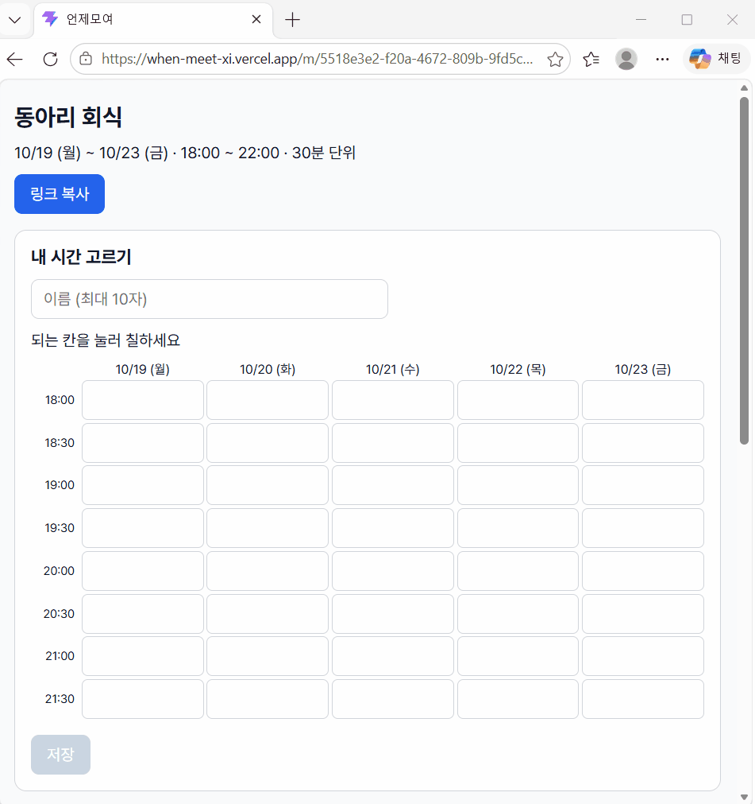
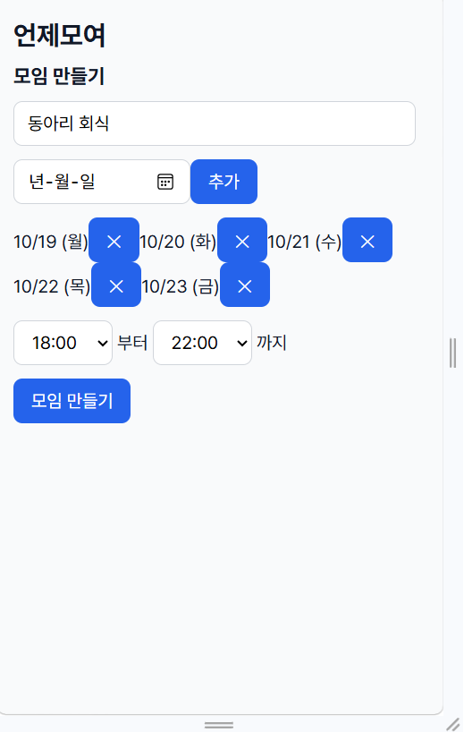
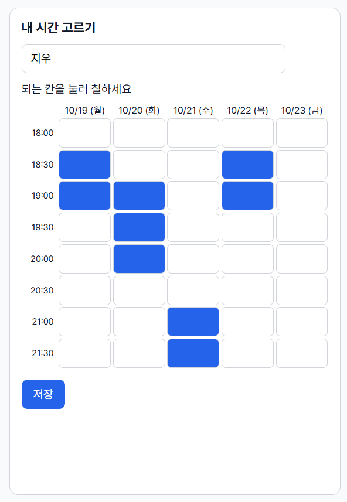
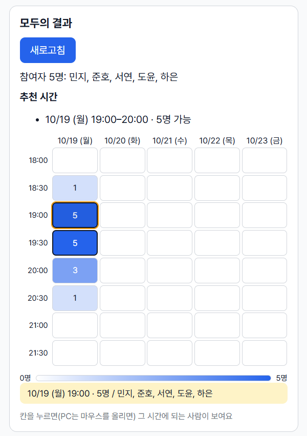
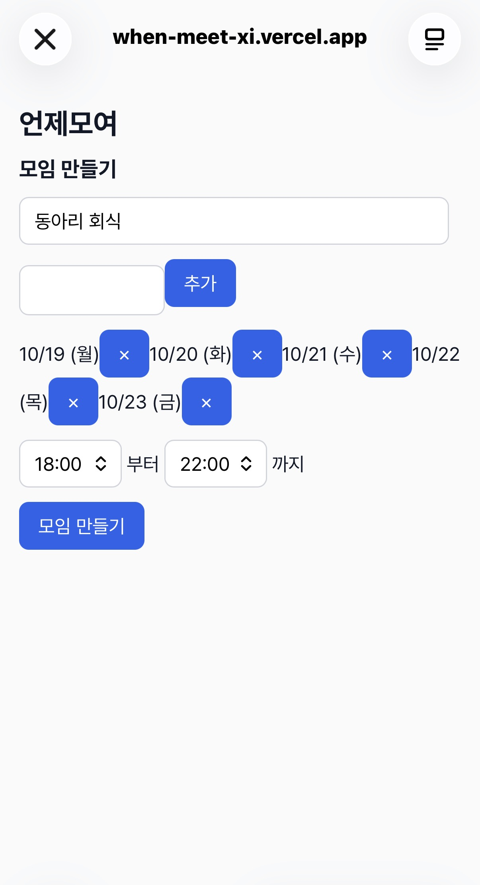
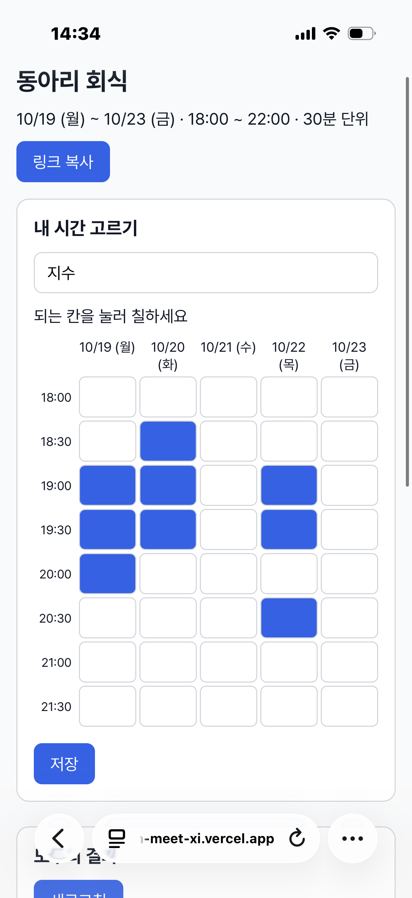
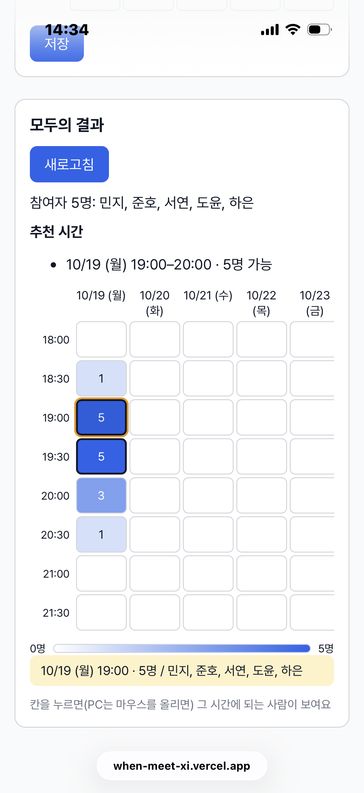
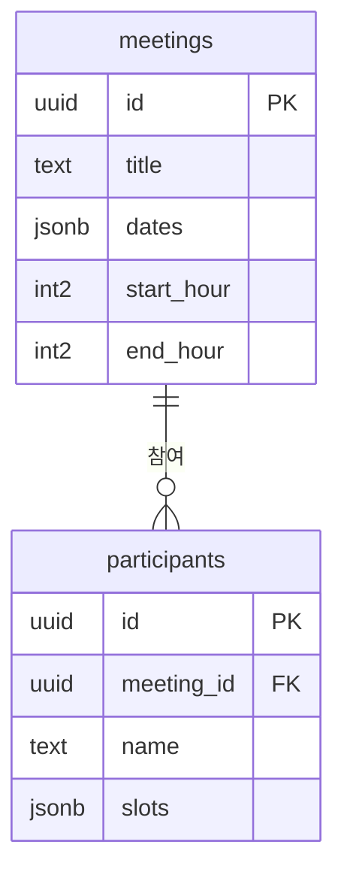

# 언제모여


> 링크 하나로 끝내는 모임 시간 조율 서비스

각자 되는 시간을 표에 칠하기만 하면, 모두가 겹치는 시간이 자동으로 진하게 보여요. 로그인 없이 링크와 이름만으로 쓸 수 있어요.

## 배포 주소

👉 https://when-meet-xi.vercel.app

> Supabase 무료 플랜은 1주일 넘게 사용이 없으면 일시정지될 수 있어요. 데모가 열리지 않으면 연락 주세요.

## 데모



| 모임 만들기 | 시간 고르기 | 결과 |
| --- | --- | --- |
|  |  |  |

| 휴대폰 1 | 휴대폰 2 | 휴대폰 3 |
| --- | --- | --- |
|  |  |  |

## 주요 기능

| ID | 기능 | 설명 |
| --- | --- | --- |
| F-01 | 모임 만들기 | 제목, 후보 날짜, 시간 범위를 입력하면 `/m/모임id` 링크 생성 |
| F-02 | 링크로 접속 | 없는 모임 주소면 안내 화면 |
| F-03 | 시간 선택 | 30분 단위 칸을 클릭해 선택·해제 |
| F-04 | 선택 저장 | 같은 이름으로 다시 저장하면 덮어쓰기, 다시 들어오면 예전 선택 불러오기 |
| F-05 | 결과 히트맵 | 가능한 인원이 많을수록 진하게, 칸 안에 인원 수 표시 |
| F-06 | 링크 복사 | 버튼 하나로 모임 주소 복사 |
| F-07 | 모바일 대응 | 휴대폰에서도 선택·결과 확인 |
| F-08 | 추천 시간 | 가장 많이 겹치는 이어진 구간을 최대 3개 표시 |
| F-09 | 가능한 사람 보기 | 결과 칸에서 가능한 사람 이름 표시 |

## 기술 스택과 선택 이유

| 구분 | 기술 | 고른 이유 |
| --- | --- | --- |
| 화면 | React + Vite | 시간표는 칸 수십 개가 클릭할 때마다 바뀌는 화면이라, 데이터(상태)만 바꾸면 화면이 다시 그려지는 React가 잘 맞았어요. Vite는 설정 없이 바로 시작할 수 있고 저장하면 화면이 바로 바뀌어요. |
| 데이터 | Supabase (PostgreSQL) | 2명이 1주일 안에 끝내야 해서 서버(API)를 따로 만들 시간이 없었어요. 테이블만 만들면 화면에서 바로 저장·조회할 수 있고, "같은 이름은 한 사람" 같은 규칙은 DB 제약(unique)과 보안 규칙(RLS)으로 지켰어요. |
| 배포 | Vercel | main에 합치면 자동으로 배포되고, PR마다 미리보기 주소가 생겨서 리뷰할 때 화면을 바로 볼 수 있어요. |
| 자동 검사 | GitHub Actions + Vitest + oxlint | PR을 올릴 때마다 린트·테스트·빌드를 자동으로 돌려서, 깨진 코드가 main에 들어가지 않게 했어요. 인원 계산·추천 시간 함수는 화면 없이 테스트로 확인했어요. |
| 협업 | GitHub Issues · PR · 리뷰 | 기능마다 이슈 → 브랜치 → PR → 서로 리뷰 → 머지 순서로 진행했어요. |

## 데이터 구조

자세한 ERD와 컬럼 설명은 [docs/erd.md](docs/erd.md)에 있어요.



| 테이블 | 저장하는 것 |
| --- | --- |
| `meetings` | 모임 제목, 후보 날짜 목록 `["2026-10-13", ...]`, 시작·끝 시각(시) |
| `participants` | 어느 모임인지, 참여자 이름, 고른 칸 목록 `["2026-10-13_19:30", ...]` |

**데이터 약속**

- 칸 하나 = `"날짜_시각"` 문자열 (예: `"2026-10-13_19:30"`), 그 시각부터 30분
- 끝 시각은 칸으로 만들지 않아요 (18~22시 → 18:00 ~ 21:30, 8칸)
- 같은 모임 + 같은 이름(앞뒤 공백 제거)은 한 사람 → `unique (meeting_id, name)` 제약으로 덮어쓰기
- 보안(RLS): 누구나 조회·추가·수정은 가능하지만 **삭제 정책은 두지 않음**

**데이터 함수** (`src/api/meetings.js`, `src/utils/`)

| 함수 | 하는 일 |
| --- | --- |
| `createMeeting` / `getMeeting` | 모임 저장 · 조회 (없거나 잘못된 id면 `null`) |
| `saveAvailability` | 참여자 칸 저장 (같은 이름이면 덮어쓰기, upsert) |
| `getParticipants` / `getMyAvailability` | 참여자 목록 · 내 예전 선택 불러오기 |
| `countBySlot` / `namesBySlot` | 칸별 가능 인원 수 · 이름 목록 계산 |
| `bestRanges` | 가장 많이 겹치는 시간을 이어진 구간으로 묶어 최대 3개 |

## 폴더 구조

```
src/
├── pages/        화면 단위 (CreatePage, MeetingPage)            — A
├── components/   화면 조각 (TimeGrid, ResultGrid)               — A
├── api/          Supabase 저장·불러오기 함수 (meetings.js)       — B
├── lib/          Supabase 클라이언트 (supabase.js)              — B
└── utils/        계산 함수와 테스트 (countBySlot, bestSlots)     — B
supabase/
└── schema.sql    테이블·보안 규칙 생성 SQL
docs/             기획서, 요구사항, 화면 설계서, ERD, 트러블슈팅
```

## 로컬 실행

**준비물**: Node.js 22 이상, Git, Supabase 프로젝트 1개

1. 코드를 내려받고 설치해요.

```bash
git clone https://github.com/Heuttun/when-meet.git
cd when-meet
npm install
```

2. Supabase SQL Editor에서 `supabase/schema.sql`을 한 번 실행해 테이블 2개를 만들어요.
3. `.env.example`을 복사해 `.env.local`을 만들고, Supabase **Project URL**과 **공개용 키(publishable / anon)**를 넣어요.

```bash
cp .env.example .env.local          # Mac · Linux
Copy-Item .env.example .env.local   # Windows PowerShell
```

> `.env.local`은 `.gitignore`에 들어 있어 GitHub에 올라가지 않아요. secret / service_role 키는 넣지 마세요.

4. 실행하고 테스트해요.

```bash
npm run dev       # http://localhost:5173
npx vitest run    # 테스트 한 번 실행
```

## 팀과 역할

| 역할 | 이름 | 담당 |
| --- | --- | --- |
| A · 화면 | 강경태 ([@Heuttun](https://github.com/Heuttun)) | 화면 설계, 모임 만들기·시간표·결과 화면, 모바일 대응 |
| B · 데이터·배포 | 김가현 ([@ovogingeggs](https://github.com/ovogingeggs)) | 테이블 설계, 저장·조회 함수, 인원 계산과 테스트, 자동 검사, README |

## 트러블슈팅

전체 기록은 [docs/troubleshooting.md](docs/troubleshooting.md)에 있어요. 그중 원인을 설명할 수 있고 배운 점이 있는 것만 골랐어요.

### 1. 같은 사람이 다시 저장하면 두 줄이 생길 뻔함 (B)

- **문제:** 같은 이름으로 다시 저장하면 새 줄이 추가되면 안 된다.
- **원인:** 그냥 insert하면 중복 줄이 생기고, unique 제약이 있으면 `23505` 에러가 난다. 또 `" 철수 "`와 `"철수"`는 다른 글자로 취급된다.
- **해결:** `(meeting_id, name)` unique 제약 + `upsert(onConflict: 'meeting_id,name')`로 "없으면 추가, 있으면 수정". 저장 전에 `name.trim()`.
- **배운 점:** 데이터 규칙은 화면이 아니라 DB 제약으로 지키면 어디서 저장해도 안전하다.

### 2. 없는 모임 주소에서 콘솔 에러 (B)

- **문제:** `/m/test`처럼 없는 주소로 들어가면 "없는 모임" 화면은 잘 나오는데, 콘솔에 `22P02` 에러가 떴다.
- **원인:** `getMeeting`에는 `22P02`(id가 uuid 모양이 아님) 처리를 넣었지만, 같은 id를 받는 `getParticipants`에는 빠져 있었다.
- **해결:** 데이터 점검 중 발견 → 이슈 #26 → `22P02`면 빈 배열 `[]`을 돌려주도록 수정 (PR #27).
- **배운 점:** 한 함수에서 예외를 처리했으면, 같은 입력을 받는 비슷한 함수도 같이 확인해야 한다.

### 3. 휴대폰에서 시간표 때문에 페이지 전체가 옆으로 밀림 (A)

- **문제:** 360px 휴대폰 화면에서 날짜가 많은 모임을 열면, 표만 넘치는 게 아니라 제목과 버튼까지 페이지 전체가 옆으로 밀렸다. 표를 `overflow-x: auto` 상자로 감쌌는데도 스크롤이 생기지 않았다.
- **원인:** CSS Grid 안의 칸(`section`)은 기본값이 `min-width: auto`라서 "내 내용보다 작아지지 않는다". 넓은 표가 section을 밀고, section이 페이지를 밀었기 때문에 안쪽 스크롤 상자가 일할 기회가 없었다.
- **해결:** `.meeting-layout > section { min-width: 0 }`을 넣어 칸이 내용보다 작아질 수 있게 했다. 그 안의 `.grid-scroll { overflow-x: auto }`에서만 표가 스크롤되도록 바꿨다. 칸 너비는 `minmax(56px, 1fr)`로 정해 PC에서는 넓게 펴지고, 휴대폰에서는 56px에서 멈추게 했다.
- **배운 점:** grid/flex 안에서 스크롤이 안 생기면 먼저 부모 칸의 `min-width`를 의심한다. 휴대폰 확인은 날짜가 많은 "최악의 경우" 데이터로 해야 문제가 보인다.

### 4. 디자인 작업이 main 브랜치에 들어가고, 합칠 때 충돌 발생 (A)

- **문제:** 모바일·디자인 코드를 다 붙여넣었는데 작업 브랜치에서는 반영이 안 보였다. 확인해 보니 `main`에서 작업하고 있었다. 브랜치를 옮겨 최신 main을 합치자 `MeetingPage.jsx`에서 CONFLICT가 났다.
- **원인:** 작업 전에 지금 어떤 브랜치에 있는지 확인하지 않았다. 그사이 main에 추천 시간 PR(#29)이 합쳐지면서, 같은 파일의 같은 부분을 양쪽에서 고친 상태가 됐다.
- **해결:** `git restore .`로 main의 변경을 되돌리고 `git checkout feat/mobile-design` → `git pull origin main`을 했다. 충돌한 파일은 두 쪽 기능(추천 시간 + 디자인)이 모두 들어간 최종본으로 정리했다. 그다음 `git add .` → commit → push → PR로 올렸다.
- **배운 점:** 코드를 고치기 전에 `git branch`로 현재 브랜치를 먼저 확인한다. 같은 파일을 둘이 고치는 날에는 작업 전에 main을 먼저 당겨 와서 충돌을 작게 만든다. main 보호 규칙 덕분에 실수가 main에 바로 들어가지 않았다.

## 한계와 다음 개선

- **로그인이 없어요**: 이름만 같으면 다른 사람 응답을 덮어쓸 수 있어요. 친구끼리 쓰는 작은 모임이라 간단함을 우선했어요.
- **응답 삭제가 없어요**: 실수로 지워지지 않게 DELETE 정책을 일부러 두지 않았어요. 삭제는 관리자가 대시보드에서만 할 수 있어요.
- **실시간 갱신이 아니에요**: 다른 사람이 방금 저장한 결과는 새로고침해야 보여요. → 다음 개선: Supabase Realtime
- **시간대(타임존) 구분이 없어요**: 모두 같은 시간대(한국 시간)에 있다고 가정했어요.
- **무료 플랜 일시정지**: Supabase 무료 플랜은 오래 안 쓰면 멈출 수 있어요.

## 회고

A·B가 같이 쓴 회고는 [docs/retrospective.md](docs/retrospective.md)에 있어요.