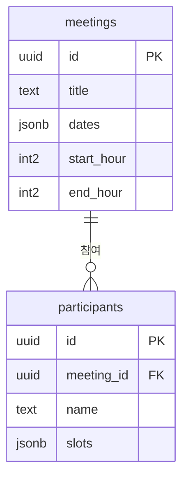

# 언제모여


> 링크 하나로 끝내는 모임 시간 조율 서비스

각자 되는 시간을 표에 칠하기만 하면, 모두가 겹치는 시간이 자동으로 진하게 보여요. 로그인 없이 링크와 이름만으로 쓸 수 있어요.

## 배포 주소

👉 (Day 7에 공개 배포 주소 입력)

> Supabase 무료 플랜은 1주일 넘게 사용이 없으면 일시정지될 수 있어요. 데모가 열리지 않으면 연락 주세요.

## 데모

(Day 7에 GIF 추가: 모임 만들기 → 시간 선택 → 결과 히트맵)

## 주요 기능

| ID | 기능 | 설명 |
| --- | --- | --- |
| F-01 | 모임 만들기 | 제목, 후보 날짜, 시간 범위를 입력하면 `/m/모임id` 링크 생성 |
| F-02 | 링크로 접속 | 없는 모임 주소면 안내 화면 |
| F-03 | 시간 선택 | 30분 단위 칸을 클릭해 선택·해제 |
| F-04 | 선택 저장 | 같은 이름으로 다시 저장하면 덮어쓰기, 다시 들어오면 예전 선택 불러오기 |
| F-05 | 결과 히트맵 | 가능한 인원이 많을수록 진하게, 칸 안에 인원 수 표시 |
| F-06 | 링크 복사 | 버튼 하나로 모임 주소 복사 |
| F-07 | 모바일 대응 | 휴대폰에서도 선택·결과 확인 |
| F-08 | 추천 시간 | 가장 많이 겹치는 이어진 구간을 최대 3개 표시 |
| F-09 | 가능한 사람 보기 | 결과 칸에서 가능한 사람 이름 표시 |

## 기술 스택과 선택 이유

| 구분 | 기술 | 선택 이유 |
| --- | --- | --- |
| 화면 | React (Vite) | 컴포넌트 단위로 화면을 나눠 두 사람이 나눠 개발하기 좋음 |
| 데이터 | Supabase (PostgreSQL) | 서버 코드 없이 화면에서 바로 저장·조회 가능해 1주일 안에 완성 가능 |
| 배포 | Vercel | GitHub에 합치면 자동 배포 |
| 협업 | GitHub (Issues, PR, Actions) | 할 일 관리, 코드 리뷰, 자동 검사(린트·테스트·빌드)를 한 곳에서 |

## 데이터 구조

자세한 ERD와 컬럼 설명은 [docs/erd.md](docs/erd.md)에 있어요.



| 테이블 | 저장하는 것 |
| --- | --- |
| `meetings` | 모임 제목, 후보 날짜 목록 `["2026-10-13", ...]`, 시작·끝 시각(시) |
| `participants` | 어느 모임인지, 참여자 이름, 고른 칸 목록 `["2026-10-13_19:30", ...]` |

**데이터 약속**

- 칸 하나 = `"날짜_시각"` 문자열 (예: `"2026-10-13_19:30"`), 그 시각부터 30분
- 끝 시각은 칸으로 만들지 않아요 (18~22시 → 18:00 ~ 21:30, 8칸)
- 같은 모임 + 같은 이름(앞뒤 공백 제거)은 한 사람 → `unique (meeting_id, name)` 제약으로 덮어쓰기
- 보안(RLS): 누구나 조회·추가·수정은 가능하지만 **삭제 정책은 두지 않음**

**데이터 함수** (`src/api/meetings.js`, `src/utils/`)

| 함수 | 하는 일 |
| --- | --- |
| `createMeeting` / `getMeeting` | 모임 저장 · 조회 (없거나 잘못된 id면 `null`) |
| `saveAvailability` | 참여자 칸 저장 (같은 이름이면 덮어쓰기, upsert) |
| `getParticipants` / `getMyAvailability` | 참여자 목록 · 내 예전 선택 불러오기 |
| `countBySlot` / `namesBySlot` | 칸별 가능 인원 수 · 이름 목록 계산 |
| `bestRanges` | 가장 많이 겹치는 시간을 이어진 구간으로 묶어 최대 3개 |

## 폴더 구조

```
src/
├── pages/        화면 단위 (CreatePage, MeetingPage)            — A
├── components/   화면 조각 (TimeGrid, ResultGrid)               — A
├── api/          Supabase 저장·불러오기 함수 (meetings.js)       — B
├── lib/          Supabase 클라이언트 (supabase.js)              — B
└── utils/        계산 함수와 테스트 (countBySlot, bestSlots)     — B
supabase/
└── schema.sql    테이블·보안 규칙 생성 SQL
docs/             기획서, 요구사항, 화면 설계서, ERD, 트러블슈팅
```

## 로컬 실행

**준비물**: Node.js 22 이상, Git, Supabase 프로젝트 1개

```bash
git clone https://github.com/Heuttun/when-meet.git
cd when-meet
npm install
```

1. Supabase SQL Editor에서 `supabase/schema.sql`을 한 번 실행해 테이블 2개를 만들어요.
2. `.env.example`을 복사해 `.env.local`을 만들고, Supabase **Project URL**과 **공개용 키(publishable / anon)**를 넣어요.
```bash
   cp .env.example .env.local              # Mac · Linux
   Copy-Item .env.example .env.local       # Windows PowerShell
```
   > `.env.local`은 `.gitignore`에 들어 있어 GitHub에 올라가지 않아요. secret / service_role 키는 넣지 마세요.
3. 실행하고 테스트해요.
```bash
   npm run dev       # http://localhost:5173
   npx vitest run    # 테스트 한 번 실행
```

## 팀과 역할

| 역할 | 이름 | 담당 |
| --- | --- | --- |
| A · 화면 | 강경태 ([@Heuttun](https://github.com/Heuttun)) | 화면 설계, 모임 만들기·시간표·결과 화면, 모바일 대응 |
| B · 데이터·배포 | 김가현 ([@ovogingeggs](https://github.com/ovogingeggs)) | 테이블 설계, 저장·조회 함수, 인원 계산과 테스트, 자동 검사, README |

## 트러블슈팅

(Day 7에 [docs/troubleshooting.md](docs/troubleshooting.md)에서 대표 사례 3개 정리)

## 회고

(Day 7에 작성)