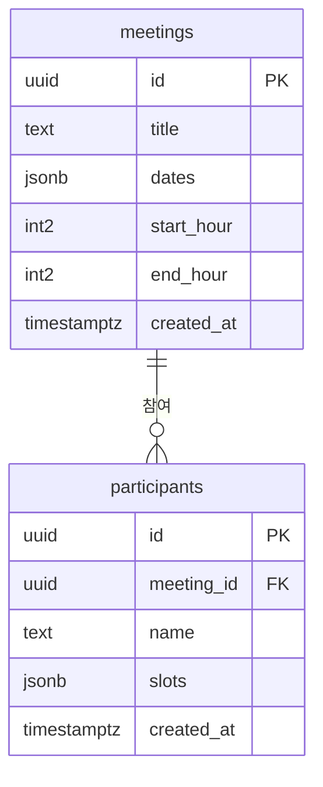

# ERD · 테이블 설계서

## meetings (모임)
| 컬럼 | 타입 | 설명 |
|---|---|---|
| id | uuid | 모임 고유 번호 (자동 생성, PK) |
| title | text | 모임 제목 |
| dates | jsonb | 후보 날짜 목록 예: ["2026-10-12", "2026-10-13"] |
| start_hour | int2 | 시작 시각 (0~23) |
| end_hour | int2 | 끝 시각 (1~24) |
| created_at | timestamptz | 만든 시각 (자동) |

## participants (참여자)
| 컬럼 | 타입 | 설명 |
|---|---|---|
| id | uuid | 참여자 고유 번호 (자동 생성, PK) |
| meeting_id | uuid | 어느 모임인지 (meetings.id 참조, FK) |
| name | text | 참여자 이름 (모임마다 하나) |
| slots | jsonb | 고른 칸 목록 예: ["2026-10-12_09:30"] (기본값 []) |
| created_at | timestamptz | 처음 저장한 시각 (자동) |

## 칸 문자열 약속
- 칸 하나 = `"2026-10-12_09:30"` (날짜_시각, 30분 단위)
- 칸 하나는 그 시각부터 30분이에요. 끝 시각은 칸으로 만들지 않아요. (18~22시 모임 → 18:00 ~ 21:30, 8칸)

## 설계 이유
- 같은 이름은 덮어쓰려고 `meeting_id + name`을 unique로 설정 (`uniq_meeting_name`)
- 로그인이 없어서 누구나 조회·추가·수정은 가능하지만, 아무나 지우지 못하게 삭제(delete) 정책은 만들지 않음