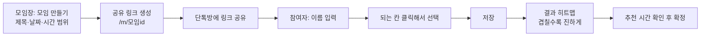

# 언제모여 프로젝트 기획서

> 링크 하나로 끝내는 모임 시간 조율 서비스

| 항목 | 내용 |
| --- | --- |
| 서비스명 | 언제모여 |
| 개발 기간 | 2026.10.09 (금) ~ 2026.10.15 (목), 7일 |
| 팀 구성 | 2명: 강경태 (화면 담당), 김가현 (데이터·배포 담당) |
| 배포 주소 | (배포 후 입력) |
| 레포지토리 | https://github.com/Heuttun/when-meet |

---

## 1. 기획 배경

### 우리가 겪은 일

팀원 둘이 함께 활동하는 스터디(6명)에서 시험 기간 보충 모임을 한 번 잡으려다 생긴 일입니다. 단톡방에 "다음 주에 언제 돼?"를 올리자 "월요일 저녁 7시 이후요", "화요일은 수업 끝나는 4시부터 6시까지", "수요일 빼고 다 돼요" 같은 답이 하루 동안 띄엄띄엄 올라왔습니다. 중간에 다른 대화가 끼면서 답장은 위로 밀려 올라갔고, 결국 모임장이 메모장에 사람별로 옮겨 적고 겹치는 시간을 손으로 찾았습니다.

그렇게 정한 시간은 한 명이 "아 그날 저 안 된다고 했는데요"라고 말하면서 다시 뒤집혔고, 날짜를 확정하기까지 사흘이 걸렸습니다. 메신저 투표도 써 봤지만 날짜는 고를 수 있어도 "몇 시부터 몇 시까지"를 받을 수는 없었습니다.

### 문제 정리

이 경험을 정리하면, 단톡방으로 시간을 정하는 방식에는 세 가지 문제가 있습니다.

- **답장이 흩어집니다.** "월요일 저녁 7시 이후", "화요일은 8시까지만"처럼 조건이 섞인 답을 누군가 모아서 정리해야 합니다.
- **시간대까지 맞추기 어렵습니다.** 메신저 투표는 날짜를 고르기에는 편하지만, 날짜별로 몇 시부터 몇 시까지 되는지를 받기에는 불편합니다.
- **정리하는 사람만 고생합니다.** 모임장이 모든 답을 표로 옮겨 겹치는 시간을 직접 찾아야 합니다.

**언제모여**는 각자 되는 시간을 표에 칠하기만 하면, 모두가 겹치는 시간이 자동으로 진하게 보이도록 만들어 이 정리 과정을 없앱니다.

## 2. 목표

| 구분 | 목표 |
| --- | --- |
| 서비스 목표 | 모임 시간을 정하는 데 드는 메시지 왕복을 링크 1번 공유로 줄인다 |
| 프로젝트 목표 | 7일 안에 기획 → 설계 → 개발 → 배포 → 실사용 테스트까지 한 사이클을 완주한다 |
| 학습 목표 | React 화면 개발, 데이터베이스 연동, Git 협업(브랜치·PR·리뷰), 자동 배포를 직접 경험한다 |

**성공 기준**

- 배포 주소로 누구나 접속해 모임 만들기 → 시간 선택 → 결과 확인을 끝까지 할 수 있다
- 팀 외부 사용자 5명 이상이 실제로 써 보고 피드백을 남긴다
- 처음 들어온 사람이 설명 없이 3분 안에 자기 시간을 저장할 수 있다

## 3. 타깃 사용자

4~10명이 한 번 모일 시간을 정해야 하는 사람들입니다. 동아리, 스터디, 팀 프로젝트, 친구 모임이 대표적입니다.

**대표 사용자**

> 대학생 지은(22세)은 6명짜리 스터디의 모임장입니다. 매주 단톡방에 "이번 주 언제 돼?"를 올리고, 흩어진 답장을 메모장에 옮겨 겹치는 시간을 찾느라 20분씩 씁니다. 답을 안 한 사람에게 다시 묻는 것도 지은의 몫입니다.

| 사용자 | 원하는 것 |
| --- | --- |
| 모임을 만드는 사람 | 후보 날짜만 정해서 링크로 뿌리고, 결과를 한눈에 보고 싶다 |
| 링크를 받은 사람 | 가입 없이 빠르게, 휴대폰으로도 쉽게 자기 시간을 입력하고 싶다 |

## 4. 기존 방법과 비교

| 방법 | 아쉬운 점 | 언제모여 |
| --- | --- | --- |
| 단톡방에 직접 묻기 | 답장이 흩어지고 정리를 사람이 해야 함 | 겹치는 시간을 자동으로 계산 |
| 메신저 투표 | 날짜 단위 선택에 적합, 시간대 입력은 불편 | 30분 단위로 날짜별 시간대 입력 |
| 해외 일정 조율 서비스 | 영어 화면, 모바일에서 다루기 불편한 경우가 있음 | 한국어 화면, 모바일 우선 설계 |

## 5. 핵심 사용 흐름

## 6. 주요 기능

세부 요구사항과 완료 조건은 [요구사항 정의서](requirements.md)에 정리했습니다.

| ID | 기능 | 설명 | 우선순위 | 담당 |
| --- | --- | --- | --- | --- |
| F-01 | 모임 만들기 | 제목, 후보 날짜, 시작·끝 시각 입력 | 필수 | A·B |
| F-02 | 링크 접속 | `/m/모임id` 주소로 모임 페이지 열기 | 필수 | A·B |
| F-03 | 시간 선택 | 이름 입력 후 30분 단위 칸을 클릭해 선택·해제 | 필수 | A |
| F-04 | 선택 저장 | 같은 이름으로 다시 저장하면 덮어쓰기 | 필수 | B |
| F-05 | 결과 히트맵 | 가능한 인원이 많을수록 진한 색으로 표시 | 필수 | A·B |
| F-06 | 링크 복사 | 버튼 하나로 모임 주소 복사 | 필수 | A |
| F-07 | 모바일 대응 | 휴대폰 화면에서도 선택·결과 확인 가능 | 필수 | A |
| F-08 | 추천 시간 | 가장 많이 겹치는 시간 강조 | 선택 | A·B |
| F-09 | 가능한 사람 보기 | 결과 칸을 누르면 가능한 사람 이름 표시 | 선택 | A·B |

## 7. 이번 범위에서 제외하는 것

7일 안에 핵심 흐름을 완성하기 위해 아래 기능은 다음 개선 과제로 미룹니다.

| 기능 | 제외 이유 |
| --- | --- |
| 회원가입·로그인 | 링크만으로 쓰는 가벼운 경험이 핵심이라 이번에는 제외 |
| 드래그로 여러 칸 선택 | 클릭 선택으로 먼저 완성하고, 시간이 남으면 추가 |
| 실시간 반영 | 새로고침 버튼으로 대신하고, 다음 단계에서 도입 검토 |
| 캘린더 연동·알림 | 외부 서비스 연동이 필요해 1주일 범위를 넘음 |

## 8. 기술 스택

| 구분 | 기술 | 선택 이유 |
| --- | --- | --- |
| 화면 | React (Vite) | 컴포넌트 단위로 화면을 나눠 두 사람이 나눠 개발하기 좋음 |
| 데이터 | Supabase (PostgreSQL) | 서버 코드 없이 화면에서 바로 저장·조회 가능해 1주일 안에 완성 가능 |
| 배포 | Vercel | GitHub에 합치면 자동 배포, 별도 서버 관리 불필요 |
| 협업 | GitHub (Issues, PR, Actions) | 할 일 관리, 코드 리뷰, 자동 검사를 한 곳에서 처리 |

## 9. 팀 구성과 역할

| 역할 | 이름 | 담당 |
| --- | --- | --- |
| A · 화면 담당 | 강경태 ([@Heuttun](https://github.com/Heuttun)) | 화면 설계, 모임 만들기·시간표·결과 화면, 모바일 대응, 데모 자료 |
| B · 데이터·배포 담당 | 김가현 ([@ovogingeggs](https://github.com/ovogingeggs)) | 테이블 설계, 저장·조회 함수, 인원 계산과 테스트, 자동 검사, README |

## 10. 일정

| 일차 | 날짜 | 목표 | A · 강경태 (화면) | B · 김가현 (데이터·배포) |
| --- | --- | --- | --- | --- |
| 1일차 | 10/09 (금) | 기획·설계, 첫 배포 | 기획서, 화면 설계서, 배포 연결 | 테이블 생성, ERD, Issue 등록 |
| 2일차 | 10/10 (토) | 모임 만들기 | 모임 만들기 화면, 페이지 이동 | 모임 저장·조회 함수 |
| 3일차 | 10/11 (일) | 시간 선택 | 시간표 그리드 | 참여자 시간 저장 함수 |
| 4일차 | 10/12 (월) | 결과 보기 | 결과 히트맵 화면 | 칸별 인원 계산, 테스트 코드 |
| 5일차 | 10/13 (화) | 공유·실사용 | 링크 복사, 버그 수정 | 재방문 처리, 자동 검사, 사용자 테스트 |
| 6일차 | 10/14 (수) | 완성도 | 모바일, 디자인 다듬기 | 추천 시간, 보안 점검 |
| 7일차 | 10/15 (목) | 정리 | 스크린샷·GIF | README, 회고 |

## 11. 위험 요소와 대응

| 위험 | 대응 |
| --- | --- |
| 처음 쓰는 기술이라 일정이 밀림 | 4일차까지 핵심 흐름(F-01~F-05)이 안 되면 선택 기능(F-08, F-09)을 제외 |
| 두 사람 작업이 합칠 때 충돌 | 담당 폴더를 나누고, 매일 하루 끝에 PR을 합침 |
| 화면과 데이터의 형식이 안 맞음 | 칸 하나를 `"2026-10-12_09:30"` 문자열로 약속하고 문서에 기록 |
| 로그인이 없어 아무나 수정 가능 | 삭제는 막고, 이번 범위의 한계로 문서에 명시 |
