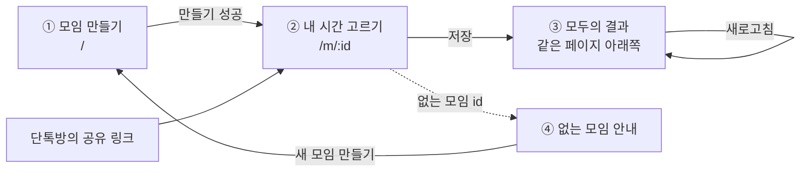
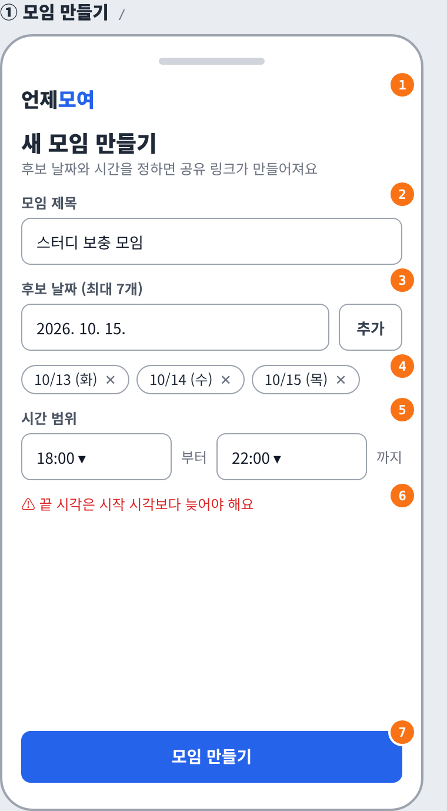
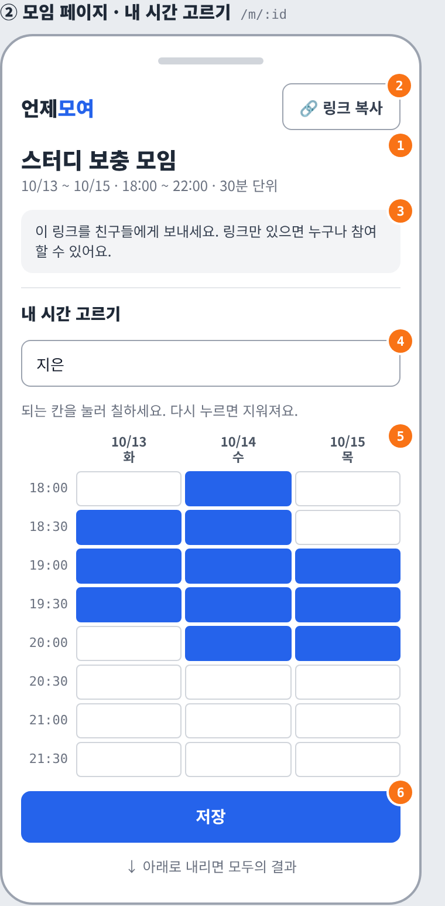
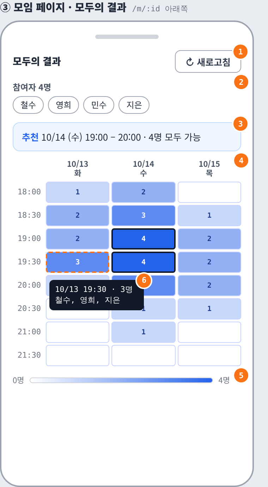
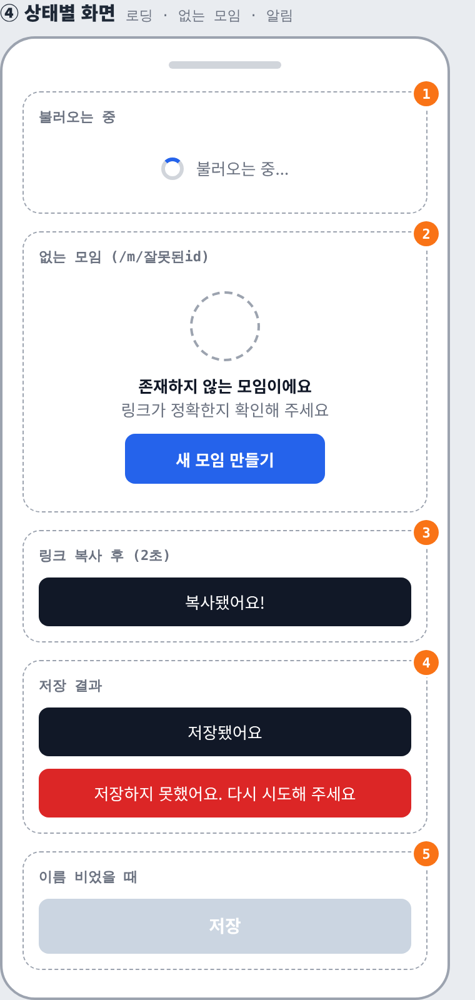

# 언제모여 화면 설계서

| 항목 | 내용 |
| --- | --- |
| 작성 | 강경태 (A · 화면 담당) |
| 작성일 | 2026.10.10 |
| 버전 | ver.1 (B와 논의 전 초안) |
| 기준 화면 | 휴대폰 세로 (너비 360px). 넓은 화면은 아래 "반응형 규칙" 참고 |
| 관련 문서 | [요구사항 정의서](requirements.md) · [ERD·테이블 설계서](erd.md) |

와이어프레임의 주황색 번호는 아래 표의 번호와 같습니다. 표의 **요구사항** 열은 [요구사항 정의서](requirements.md)의 ID입니다.

---

## 0. 화면 흐름

- 페이지는 **2개**뿐입니다. `/`(모임 만들기)와 `/m/:id`(모임 페이지)이고, 모임 페이지 안에 "내 시간 고르기"와 "모두의 결과"가 위아래로 있습니다.
- 모임장도 모임을 만든 뒤 자기 시간을 같은 방법으로 입력합니다.

---

## ① 모임 만들기 `/`

| 번호 | 요소 | 동작 | 요구사항 |
| --- | --- | --- | --- |
| 1 | 로고 | 누르면 첫 화면(`/`)으로 이동 | — |
| 2 | 모임 제목 입력 | 앞뒤 공백 제거 후 1~30자 | F-01-1 |
| 3 | 날짜 선택 + 추가 버튼 | 날짜를 고르고 "추가"를 누르면 4번 목록에 들어감. 오늘 이전 날짜, 이미 있는 날짜, 8번째 날짜는 추가하지 않고 안내 | F-01-2 |
| 4 | 추가된 날짜 목록 | 날짜순으로 정렬해 `10/13 (화)` 형식으로 표시. ✕를 누르면 삭제 | F-01-2 |
| 5 | 시간 범위 | 시작·끝 시각을 1시간 단위로 선택. 기본값 09:00 ~ 22:00 | F-01-3 |
| 6 | 오류 안내 | 만들기를 눌렀을 때 규칙에 어긋난 항목 아래에 빨간 글씨로 표시. 고치면 사라짐 | F-01-4 |
| 7 | 모임 만들기 버튼 | 화면 아래에 고정. 누르면 저장 → 성공 시 `/m/모임id`로 이동. 저장 중에는 "만드는 중..."으로 바뀌고 다시 누를 수 없음 | F-01-5 ~ 7 |

**오류 문구**

| 상황 | 문구 |
| --- | --- |
| 제목 없음 | 모임 제목을 입력해 주세요 |
| 제목 30자 초과 | 30자 이내로 입력해 주세요 |
| 날짜 0개 | 날짜를 하나 이상 추가해 주세요 |
| 같은 날짜 | 이미 추가한 날짜예요 |
| 시작 ≥ 끝 | 끝 시각은 시작 시각보다 늦어야 해요 |
| 저장 실패 | 모임을 만들지 못했어요. 다시 시도해 주세요 |

---

## ② 모임 페이지 · 내 시간 고르기 `/m/:id`

| 번호 | 요소 | 동작 | 요구사항 |
| --- | --- | --- | --- |
| 1 | 모임 정보 | 제목과 "날짜 범위 · 시간 범위 · 30분 단위" 표시 | F-02-1 |
| 2 | 링크 복사 버튼 | 현재 주소를 복사하고 "복사됐어요!"를 2초간 표시 (④-3) | F-06-1, 2 |
| 3 | 공유 안내 | **모임을 막 만들고 들어왔을 때만** 표시 | F-06-3 |
| 4 | 이름 입력 | 1~10자. 이미 저장한 이름을 입력하면 그 사람의 기존 선택을 불러와 표에 칠함 | F-03-1, F-04-4 |
| 5 | 시간표 | 날짜(가로) × 30분 시각(세로). 칸을 누르면 선택(파란색), 다시 누르면 해제. 끝 시각은 포함하지 않음 (18~22시 → 18:00~21:30, 8칸) | F-03-2 ~ 4 |
| 6 | 저장 버튼 | 이름이 비면 비활성화(④-5). 누르면 저장 → 결과 표시(④-4) → 아래 "모두의 결과"를 다시 불러옴 | F-04-1 ~ 5 |

---

## ③ 모임 페이지 · 모두의 결과 `/m/:id` 아래쪽

| 번호 | 요소 | 동작 | 요구사항 |
| --- | --- | --- | --- |
| 1 | 새로고침 버튼 | 다른 사람이 새로 저장한 결과를 다시 불러옴 | F-05-5 |
| 2 | 참여자 목록 | "참여자 N명"과 이름들. 0명이면 "아직 아무도 입력하지 않았어요" | F-05-1 |
| 3 | 추천 시간 *(선택 기능)* | 가장 많이 겹치는 이어진 구간을 최대 3개 표시. 참여자 0명이면 숨김 | F-08 |
| 4 | 결과 히트맵 | 칸마다 가능 인원 수를 숫자로 표시하고, `인원 ÷ 전체 참여자` 비율만큼 진하게 칠함. 0명은 빈 칸, 전원 가능은 가장 진한 색 + 검은 테두리 | F-05-2, 3 |
| 5 | 범례 | 0명 ~ N명 색 막대 | F-05-4 |
| 6 | 가능한 사람 보기 *(선택 기능)* | PC는 마우스를 올리면, 휴대폰은 칸을 누르면 "날짜 시각 · N명 / 이름들" 말풍선 | F-09 |

히트맵은 색만으로 구분하지 않고 칸 안에 숫자를 함께 씁니다. (NF-08)

---

## ④ 상태별 화면

| 번호 | 상태 | 표시 | 요구사항 |
| --- | --- | --- | --- |
| 1 | 모임을 불러오는 중 | 가운데에 "불러오는 중..." | F-02-2 |
| 2 | 없는 모임 id | "존재하지 않는 모임이에요" + "새 모임 만들기" 버튼(누르면 `/`) | F-02-3 |
| 3 | 링크 복사 후 | 화면 아래에 "복사됐어요!" 2초 | F-06-2 |
| 4 | 저장 결과 | 성공 "저장됐어요", 실패 "저장하지 못했어요. 다시 시도해 주세요" (빨간색) | F-04-5 |
| 5 | 이름이 비어 있을 때 | 저장 버튼 회색, 누를 수 없음 | F-04-2 |

---

## 디자인 규칙

| 항목 | 규칙 |
| --- | --- |
| 메인 색 | 파란색 `#2563eb`. 주요 버튼, 선택된 칸, 히트맵에만 사용 |
| 오류 색 | 빨간색 `#dc2626`. 오류 문구, 저장 실패에만 사용 |
| 글꼴 | Pretendard (없으면 시스템 기본 글꼴) |
| 누르는 크기 | 버튼 높이 40px 이상, 시간표 칸 높이 30px 이상 |
| 여백 | 화면 양옆 16px, 묶음 사이 12~24px |
| 시간표 폭 | 날짜가 많아 화면보다 넓으면 **표만** 가로 스크롤 (F-07-2) |

## 반응형 규칙

| 화면 너비 | 배치 |
| --- | --- |
| 768px 이하 (휴대폰) | "내 시간 고르기" 아래에 "모두의 결과" (이 문서의 그림) |
| 768px 초과 (PC) | 왼쪽 "내 시간 고르기", 오른쪽 "모두의 결과"를 나란히 |

## 컴포넌트 나누기 (구현 계획)

| 컴포넌트 | 파일 | 들어가는 번호 |
| --- | --- | --- |
| `CreatePage` | `src/pages/CreatePage.jsx` | ① 전체 |
| `MeetingPage` | `src/pages/MeetingPage.jsx` | ②-1 ~ 4, ②-6, ④ 전체 |
| `TimeGrid` | `src/components/TimeGrid.jsx` | ②-5 |
| `ResultGrid` | `src/components/ResultGrid.jsx` | ③ 전체 |
